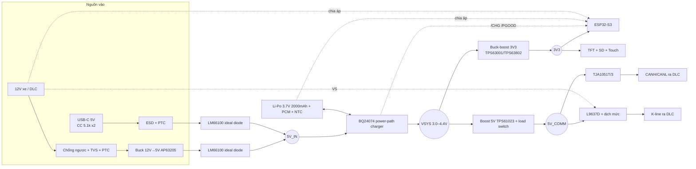

# 01 – Đánh giá sơ đồ chân & checklist thiết kế PCB

> **Lưu ý:** repo chưa có sơ đồ nguyên lý/PCB của bạn nên đây là **bản pinout chuẩn tôi đề xuất** + **danh sách lỗi hay gặp**.
> Bạn so với thiết kế hiện tại; gửi file KiCad/Altium/ảnh/PDF schematic lên repo, tôi sẽ đối chiếu từng chân.
> Mã chân dùng trong firmware: [`firmware/MotoECU/Pins.h`](../firmware/MotoECU/Pins.h).

## 1. Sơ đồ khối

## 2. Bảng chân đề xuất (ESP32-S3)

| Nhóm | Tín hiệu | GPIO | Ghi chú |
|---|---|---|---|
| SPI chung | SCK / MOSI / MISO | 12 / 11 / 13 | chân IOMUX mặc định FSPI → chạy 40–80 MHz |
| TFT | CS / DC / RST / BL | 10 / 9 / 8 / 7 | BL qua MOSFET, PWM |
| SD (tuỳ chọn) | CS | 14 | lưu dump ECU, log |
| Touch (tuỳ chọn) | CS / IRQ | 15 / 16 | XPT2046 |
| CAN | TX / RX / STB | 17 / 18 / 21 | TWAI nội của S3 + TJA1051T/3 |
| K-line | TX / RX | 38 / 39 | UART1, qua dịch mức |
| Nguồn truyền thông | COMM_5V_EN | 40 | bật boost 5V + load switch |
| **Đo nguồn** | VBAT_SENSE | **4** (ADC1) | chia áp 100k/100k |
| **Đo nguồn** | VCAR_SENSE | **5** (ADC1) | chia áp 100k/22k |
| Trạng thái sạc | /CHG, /PGOOD | 1, 2 | open-drain, kéo lên 3V3 |
| Nút | BOOT, UP, DOWN, OK | 0, 41, 42, 6 | |
| I2C (tuỳ chọn) | SDA / SCL | 35 / 36 | MAX17048, IO expander (chỉ module không PSRAM octal) |
| USB Type-C | D- / D+ | 19 / 20 | nạp code + CDC |
| Debug | UART0 TX/RX | 43 / 44 | header 3 chân |

**Chân tuyệt đối tránh:** 3, 45, 46 (strap), 26–32 (flash/PSRAM), 47/48 (vùng 1.8V trên module có PSRAM octal), 33–37 nếu dùng module **R8** (PSRAM octal).

## 3. Những chỗ hay SAI / hay THIẾU (kiểm tra schematic của bạn)

### 3.1 Chọn module ESP32-S3
- ❌ Dùng **N16R8/N8R8** (PSRAM octal) → mất GPIO35–37 và dễ đụng 47/48 ở 1.8V.
- ✅ Dùng **ESP32-S3-WROOM-1-N16R2** (hoặc N16 không PSRAM). Dump ECU 0.5–2 MB, PSRAM 2 MB là đủ, flash 16 MB để chứa file.

### 3.2 USB Type-C (nạp code + sạc)
- Thiếu **2 điện trở 5.1 kΩ CC1/CC2 → GND** là lỗi số 1: sạc C-to-C sẽ **không ra điện**.
- D+/D- đi cặp 90 Ω differential, thêm **ESD (USBLC6-2SC6)**, không vòng qua via nhiều.
- VBUS **không nối thẳng vào ESP32**, đi qua PTC → ideal diode → BQ24074.
- Có đủ nút **BOOT (GPIO0)** và **RESET (EN)** để vào chế độ nạp khi mất cổng COM. EN cần RC 10k + 1 µF.
- Arduino IDE: *USB CDC On Boot = Enabled*, *Flash Size 16MB*, *PSRAM = QSPI*.

### 3.3 CAN
- Transceiver **TJA1051T/3** (VCC 5V, VIO 3.3V → TXD/RXD logic 3.3V trực tiếp, bus chịu ±58V).
- ❌ Hay quên: **đừng gắn cứng 120 Ω**. Mạng CAN trên xe đã có 2 điện trở đầu cuối → để **jumper hàn** (mặc định hở), chỉ đóng khi test trên bàn.
- Thêm **PESD2CAN** + common-mode choke (ACT45B-510) nếu chạy bus lâu dài.
- TWAI của S3 chỉ có **1 controller** → 1 kênh CAN. Có đủ cho cả Honda lẫn Yamaha (đời mới).

### 3.4 K-line (ISO 9141 / Honda DLC / Yamaha YDT)
- Chip: **L9637D** (VS 12V, Vcc 5V).
- ❌ **Lỗi tương thích mức logic:** TxD của L9637D cần VIH ≈ 0.7·Vcc = 3.5V → **ESP32 3.3V không đủ**. Cần:
  - TX: **74AHCT1G125** (hoặc BSS138) lên 5V.
  - RX: chia áp **10k/20k** về ≤3.3V (RX ra 5V sẽ **làm hỏng GPIO** nếu nối thẳng).
- **Điện trở kéo K lên VS 510 Ω–1 kΩ** (có jumper), K-line tool phải chịu được ngắn mạch lên 12V / xuống GND.
- Thêm TVS ở chân K (SMBJ18A hoặc PESD36V).
- Khởi tạo 5-baud/fast-init phải bit-bang TX bằng GPIO trước khi chuyển sang UART (firmware xử lý).
- ⚠️ L9637D cần **VS ≥ 6V** → chỉ làm việc khi có 12V (xem 3.6).

### 3.5 Đầu vào 12V từ xe máy (khắc nghiệt hơn bạn nghĩ)
- Xe máy sạc 14.5V, **load-dump / xung > 40V**, kích đề kéo sụt áp, đảo cực khi lắp nhầm.
- Cần theo thứ tự: **cầu chì/PTC 0.5–1A → chống ngược cực (P-MOS, hoặc Schottky SS34) → TVS SMBJ18A → LC/ferrite → buck**.
- Buck chọn loại **≥32V** (AP63205, hoặc loại ô tô AP63205Q nếu có). Không dùng AMS1117/LM7805 cho 12V xe: nóng + không chịu xung.
- 12V cho K-line (VS) lấy **sau chống ngược + TVS**, trước buck.

### 3.6 ECU cần gì thêm khi ĐỌC/GHI (hay bị thiếu nhất)
Đọc chẩn đoán qua K-line/CAN chưa phải đọc/ghi flash. Thường cần:
- **Công tắc nguồn cấp ECU** (P-MOS high-side, ≥5A, có cầu chì) – vì vào chế độ bootloader phải **ngắt/cấp lại nguồn ECU** theo trình tự.
- **2–4 chân điều khiển mở-collector** tới ECU: `BOOT/MODE`, `RESET`, … qua MOSFET (N-MOS 2N7002) hoặc opto → cần thêm IO expander (MCP23017 qua I2C 35/36).
- **Header BDM/JTAG/UART** 2.54 mm cho đọc trực tiếp MCU trên bàn.
- ❓ Tôi cần bạn cho biết **đời xe & MCU ECU** (vd. Honda Vision/Lead/PCX, Yamaha Exciter/NVX/Sirius) để chốt các chân này.

### 3.7 Nguồn & nhiễu
- Cấp 3V3: bulk 22 µF + 100 nF gần chân module, 10 µF gần TFT.
- Anten WiFi/BLE: **keep-out** ≥15 mm, module chìa ra mép PCB, không đồng đổ dưới anten.
- Nối mass: mass tương tự (chia áp ADC) đi thẳng về mass nguồn, tránh dòng backlight/TFT đi qua.
- Điểm test TP cho 3V3, 5V, VSYS, VBAT, CANH/CANL, K, GPIO0/EN/TX/RX.
- Đèn LED báo: PGOOD, CHG (BQ24074 kéo trực tiếp, không tốn GPIO).

### 3.8 Chân đo (yêu cầu 7)
- Dùng **ADC1** (GPIO1–10). ADC2 (GPIO11–20) **xung đột WiFi** → đừng dùng.
- Mỗi chân 1 tụ **100 nF** sát chân ADC; chia áp tổng ≥100 kΩ để rò thấp.
- Tối đa Vcar = 3.1 V·(122/22) ≈ 17 V → 14.8V xe sạc vẫn dưới thang. Thêm **BAT54S** kẹp 3.3V chống xung.
- Sai số ADC ESP32-S3 ~±2% → dùng `analogReadMilliVolts()` (có hiệu chuẩn eFuse) + lấy trung bình 16 mẫu.
- Muốn **% pin chính xác** (không chỉ theo điện áp): thêm **MAX17048** qua I2C (2 chân 35/36). Chỉ cần ADC thì giữ 2 chân đo như trên.

## 4. Tóm tắt "thiếu / sai" ưu tiên

| # | Mức | Vấn đề |
|---|---|---|
| 1 | 🔴 | K-line: mức 5V ↔ 3.3V (TX không đủ, RX có thể cháy chân) |
| 2 | 🔴 | Đầu 12V xe: chưa có chống ngược/TVS/buck ≥32V |
| 3 | 🔴 | USB-C thiếu 5.1 kΩ CC |
| 4 | 🔴 | Hai nguồn (pin/USB/xe) nối chung không qua ideal-diode → chảy ngược |
| 5 | 🟠 | Module R8 chiếm chân; đang dùng chân strap (3/45/46) |
| 6 | 🟠 | Thiếu công tắc nguồn + chân BOOT/RESET cho ECU để ghi flash |
| 7 | 🟡 | 120 Ω CAN gắn cứng; thiếu ESD/CMC; thiếu test point |
